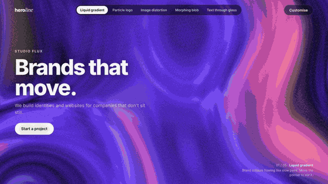
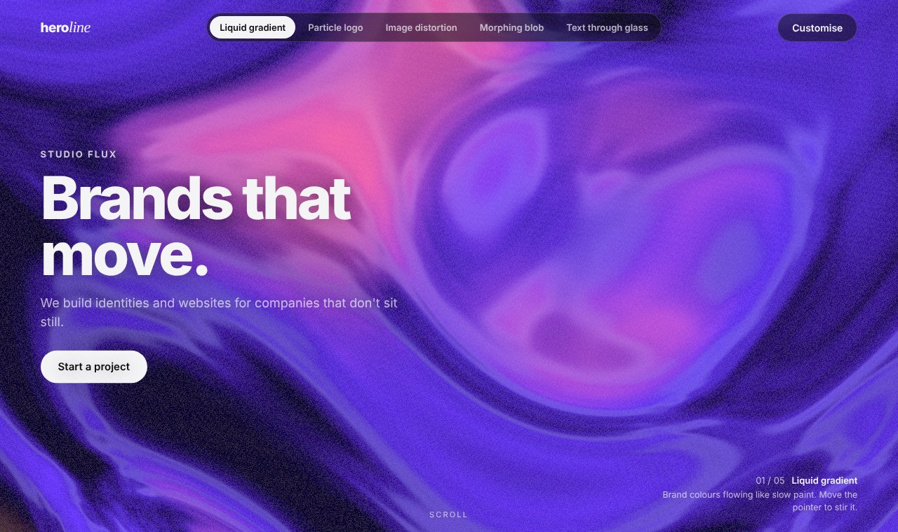
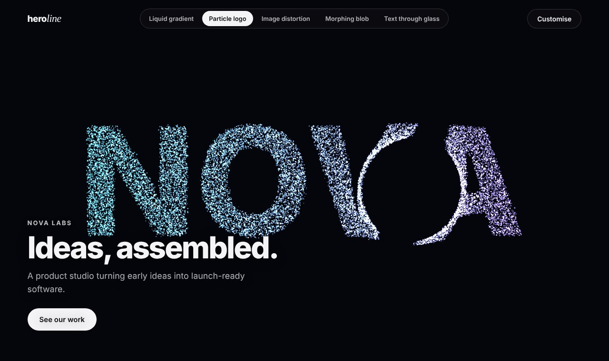
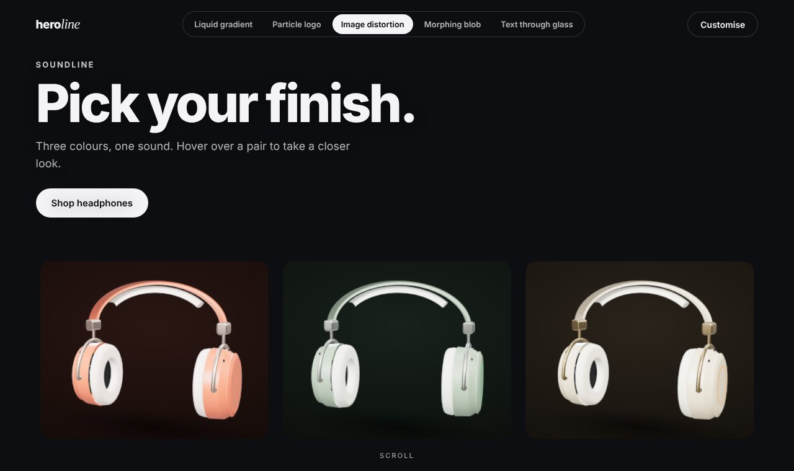
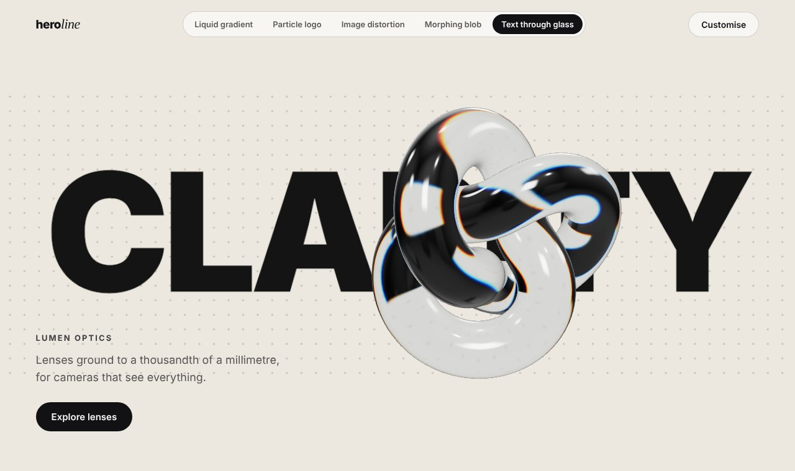
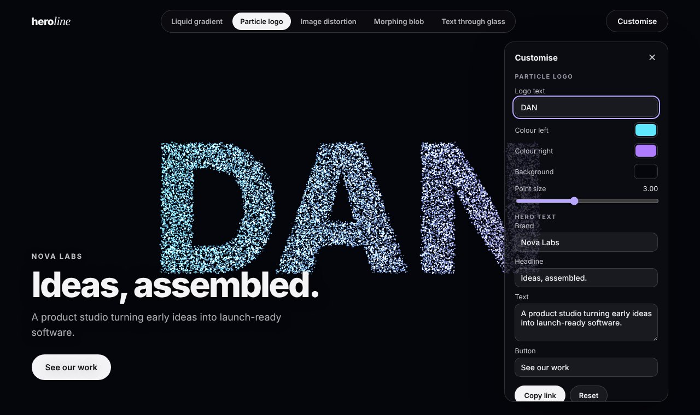
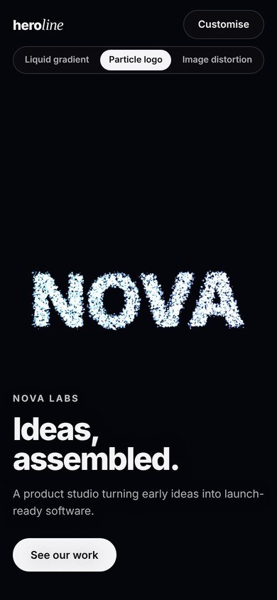
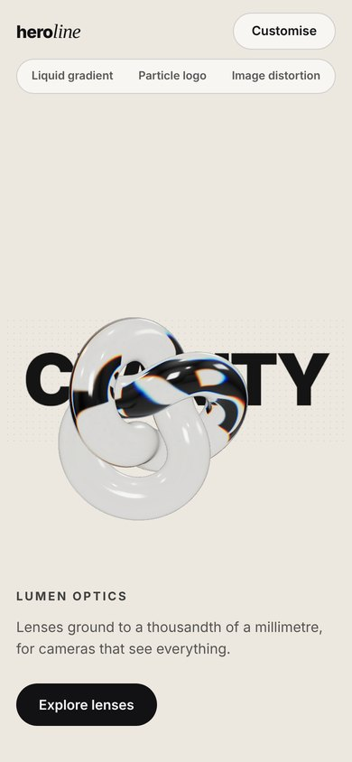

# Heroline

Five interactive WebGL hero sections: the big, moving first screen of a website. Each one is a custom shader that reacts to the pointer, clicks and the scroll, and each can be restyled live with its own colours and words, then shared as a link.

**[Open the page →](https://dandee057.github.io/heroline/)**



| | |
| --- | --- |
|  |  |
|  |  |

## The five effects

| | Effect | What it does | How |
| --- | --- | --- | --- |
| 1 | **Liquid gradient** | Brand colours flowing like slow paint; the pointer stirs it | One fragment shader: domain-warped simplex noise picks the blend of four colours per pixel. The last ten pointer positions are uniforms, each twisting the space around it as it fades, leaving a trail of swirls. |
| 2 | **Particle logo** | A word made of 22,000 glowing points; scroll scatters it, a click sends a shock wave, editing the text morphs it | The word is drawn on a hidden canvas and its pixels sampled for targets. All motion is in the vertex shader of one `Points` mesh: blend between word and cloud, noise drift, pointer repulsion, an expanding ring for clicks, and a staggered morph between the old and new word. |
| 3 | **Image distortion** | Product photos ripple like liquid under the pointer, with a colour split as it moves | Planes laid out in pixels with an orthographic camera. The fragment shader bends the photo's coordinates with noise near the pointer, splits red and blue by pointer speed, cover-fits the image and rounds its own corners with a rounded-rectangle distance. |
| 4 | **Morphing blob** | A glossy, iridescent shape that leans towards the pointer, ripples when clicked and melts as you scroll | Three's `MeshPhysicalMaterial` (clearcoat, iridescence, generated studio reflections) patched with `onBeforeCompile`: the vertex shader displaces each vertex with noise and rebuilds its normal from two displaced neighbours so the lighting stays correct. |
| 5 | **Text through glass** | One huge word, bent and split into colours by a turning glass shape that follows the pointer | Physical transmission: the scene behind the glass is rendered to a texture and read back through the surface's refraction, with dispersion for the rainbow edges. Four shapes to choose from. |

The photos in effect 3 are renders from [Soundline](https://github.com/dandee057/soundline), my scroll-driven product page.

## Customise and share

**Customise** opens a panel with the current effect's settings (colours, speed, size, shape, the logo word) and the hero's text. Changes apply instantly, and they're kept in the page address, so **Copy link** gives you a link that opens the hero exactly as you left it, for example:

```
?fx=liquid&a=0a2a1f&b=1f8a5b&c=e6ff7a&d=ffffff&h=Greenhouse|Grow faster.|Climate tech for farms.|Book a demo
```

Only settings that differ from the defaults go in the link, and anything invalid falls back to the default ([`src/state.ts`](src/state.ts), with tests).

<p>
  
  
  
</p>

## How the page is built

- **One renderer, swappable effects.** Every effect implements one small interface ([`src/effects/types.ts`](src/effects/types.ts)): `render(t, dt, input)`, `resize`, `set(values)`, `dispose`. The page owns the renderer, the hero text, the switcher and the panel; an effect owns its own scene, camera and shaders. Switching disposes the old effect and fades in the new one.
- **Input in one shape.** Pointer position and velocity, whether it's over the hero, taps and scroll progress are gathered once and handed to the effect every frame. Touch works like the pointer.
- **Only draws when it's seen.** The frame loop skips rendering when the hero is scrolled away or the tab is hidden, and the pixel ratio is capped on large screens.
- **Respects people.** With *reduce motion* on, every effect keeps its look but slows right down. Without WebGL, the hero text still shows on a plain gradient. The hero text sits where it doesn't cover the effect (left, top or bottom, per effect), and moves to a sheet at the bottom on phones.

## Running it

```bash
npm install
npm run dev      # http://localhost:5173
npm test         # the shareable-link encoding
npm run build    # type-checks, then builds to dist/
```

Press 1–5 to switch effects. To record a video, open the page with `?debug`, call `heroline.capture()`, then `heroline.shoot(t, dt, input)` draws one exact frame at time `t` with a scripted pointer; that's how the GIF above was made. **Deploying:** in the repository go to *Settings → Pages* and set *Source* to **GitHub Actions**; every push to `main` then tests, builds and deploys.

## Project structure

```
index.html               the page: hero, switcher, customise panel, the effect cards below
src/main.ts              renderer, switching, panel, input, frame loop
src/state.ts             settings and hero text <-> the page address
src/effects/types.ts     the interface every effect implements
src/effects/shared.ts    simplex noise (GLSL), full-screen quad
src/effects/liquid.ts    1 · liquid gradient
src/effects/particles.ts 2 · particle logo
src/effects/distort.ts   3 · image distortion
src/effects/blob.ts      4 · morphing blob
src/effects/glass.ts     5 · text through glass
src/style.css            layout, panel, phone layout
public/images/           the product photos for effect 3
tests/                   shareable-link encoding
```

The simplex noise is Ashima Arts and Stefan Gustavson's (MIT). The brands in the demos are made up.

## Built with

Three.js · GLSL · TypeScript · Vite

## Licence

MIT
